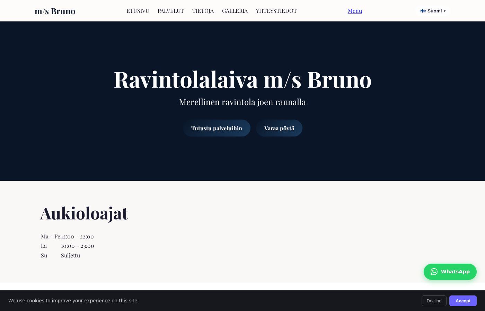
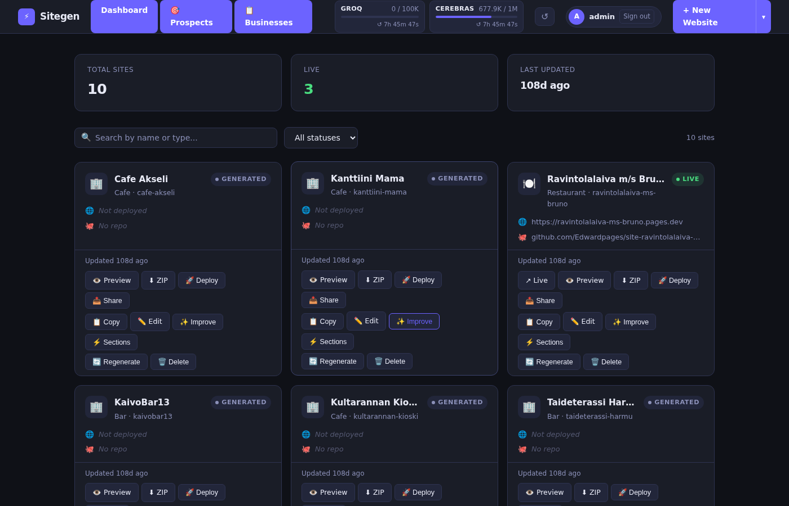
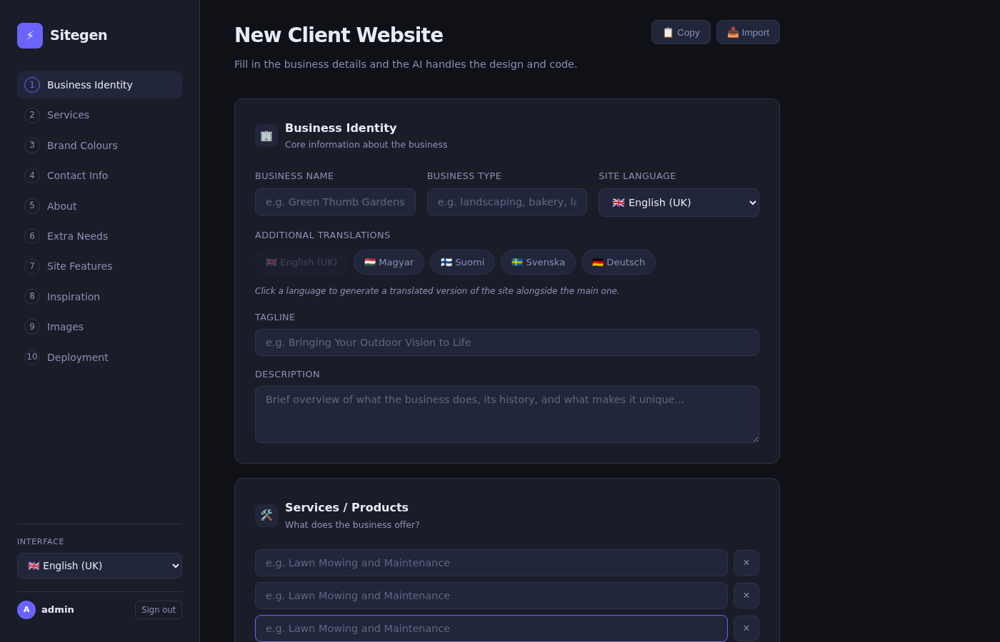
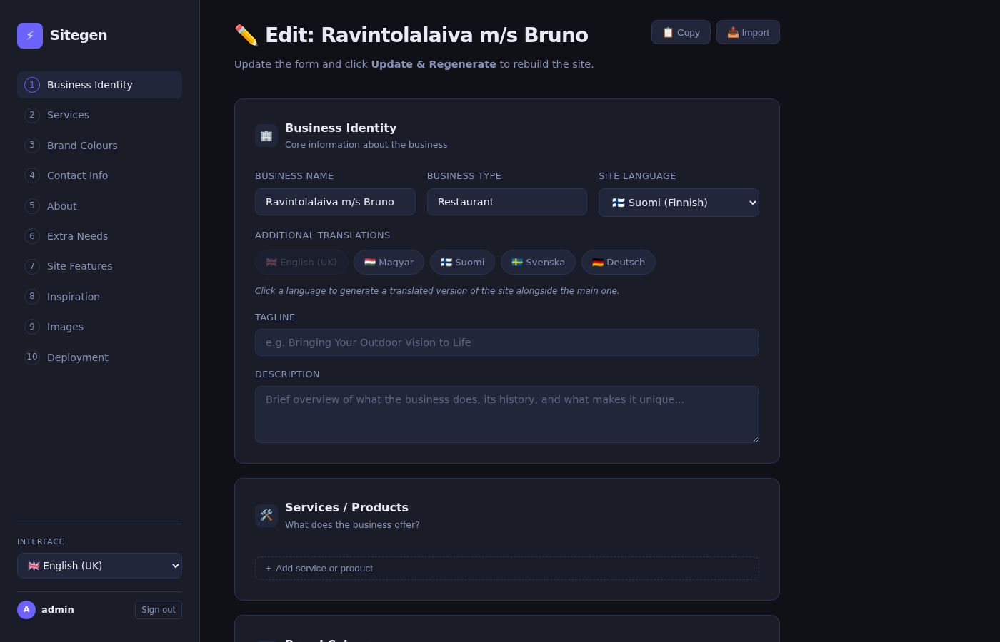

# Sitegen: AI Website Builder

Sitegen turns a client brief into a complete website and puts it online. The AI writes fresh HTML, CSS and JS every time, with no templates. Sitegen then deploys the site to Cloudflare Pages and creates a GitHub repo for it, all in about 30 to 90 seconds.

> This repository is a showcase. The source code is kept private.



*A Finnish-language restaurant site generated by Sitegen, with the language switcher, WhatsApp button and cookie consent added automatically.*

---

## Pipeline

```
10-section client brief
    ↓
Groq (primary) or Cerebras (fallback) generates the site
    ↓
Pexels API adds matching stock photos
    ↓
SEO injected: meta, Open Graph, JSON-LD LocalBusiness
    ↓
WhatsApp button, cookie consent and contact form patched in
    ↓
Deploy to Cloudflare Pages: live URL
    ↓
Create a GitHub repo and push the source
```

## Dashboard



Every client site is shown with its status (Generated or Live) and live token meters for both LLM providers. Each site has actions for preview, ZIP export, deploy, share link, edit, improve, regenerating single sections, and a full rebuild.

## The brief



The brief has 10 sections: business identity and languages, services, brand colours, contact info, about, extra instructions, site features, inspiration, images and deployment. Briefs can be exported and imported as JSON.



## Features

| Feature | Detail |
|---------|--------|
| AI generation | Groq (Llama 3.3 70B) with Cerebras as fallback |
| Style presets | Modern, Classic, Bold, Minimal |
| Design scraper | Extracts colours, fonts and spacing from any reference URL |
| Real photos | Pexels API |
| SEO | Meta tags, Open Graph, JSON-LD schema |
| Multi-language | AI translation plus a language switcher in the nav |
| Partial rebuilds | Regenerate one section, or just patch details and redeploy |
| Share preview | Public preview link with 7-day expiry |
| Prospect finder | OpenStreetMap search for local businesses with no website (Leaflet map) |
| Outreach CRM | Pipeline statuses, notes, one-click demo site |

## Stack

| Layer | Tech |
|-------|------|
| Backend | Python 3, Flask, SQLite |
| AI | Groq API, Cerebras API |
| Deployment | Cloudflare Pages API, GitHub API |
| Media and maps | Pexels API, Leaflet + OpenStreetMap |
| Auth | Session cookie + API key header |

## Author

Edvárd Nagy · [Portfolio](https://edvardna.github.io)
